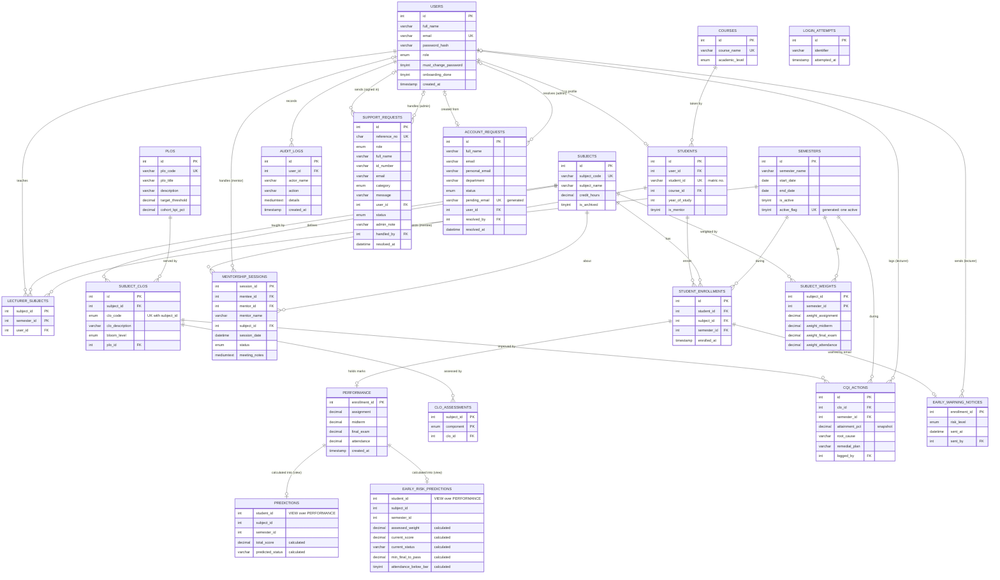

# SPTS — System Workflow & ERD Guide

> Generated from the **live database** after the September 2026 fault fixes (`database/schema.sql`). Column types are exact.

---

## PART A — SYSTEM WORKFLOW

### A1. Overall flow (big picture)

```
                         ┌──────────────────────┐
                         │  Landing Page         │
                         │  (index.php)          │
                         └──────────┬───────────┘
              ┌─────────────────────┼─────────────────────┐
              ▼                     ▼                     ▼
       Register (student)     Login (student)      Login (staff/admin)
              │                     │                     │
              └──────────► users + students               │
                                    ▼                     ▼
                  ┌── temporary password? → Change Password first ──┐
                  ▼                     ▼                           ▼
            ADMIN PORTAL         LECTURER PORTAL              STUDENT PORTAL
                  │                     │                           │
   semesters, subjects, staff,   enters marks (grid/CSV) for  views this semester's
   students, ENROLMENTS,         ENROLLED students in the     results, what-if, books
   support requests, audit log   ACTIVE semester → score,     mentorship, prints
                  │              status, audit log            multi-semester transcript
                  └──────────────────► shared database ◄──────────────────┘
```

### A2. Setup workflow (first-time install)

1. Import `database/schema.sql` and create the `spts_app` DB user (README).
2. Run `tools/create_admin.php` → first **admin** (must change password at first login).
3. Admin → **Semesters**: add the semester, *Set Active* (exactly one active semester).
4. Admin → **Staff**: add lecturers (and other admins if needed).
5. Admin → **Subjects**: add subjects, assign one lecturer each.
6. Admin adds students under **Students** (self-registration is off by default; see `ALLOW_SELF_REGISTRATION`).
7. Admin → **Enrolments**: tick which students take each subject this semester.

### A3. Authentication workflow

```
User enters email + password
        │
        ├─ CSRF token invalid? ──────────────► "Session expired"
        ├─ ≥5 failed tries in 15 min? ──────► Blocked (login_attempts)
        ▼
Look up users.email
        ├─ not found / wrong password ─► INSERT login_attempts → "Invalid email or password"
        ▼
Correct → DELETE login_attempts → new session ID
        ├─ users.must_change_password = 1 → forced to Change Password
        └─ otherwise → dashboard for role (admin / lecturer / student)

Every page: idle > 30 min → signed out ("signed out after inactivity")
Logout: POST + CSRF token only
```

**Registration.**
1. Validate the input:
   - email format
   - Student ID format `n` + 7–10 digits
   - programme belongs to the level detected from the ID
   - password: 8+ characters with a letter and a number
   - email and Student ID are unique
2. Start a transaction.
3. INSERT `users` (role = student).
4. INSERT `students`.
5. COMMIT, or ROLLBACK if anything fails.

**Contact Admin / forgot password** (admin-mediated; a request never changes an account itself):
1. "Forgot password?" or "Contact the admin" on either sign-in page opens **Contact Admin**, with no sign-in needed. The user gives their role, name, Student/Staff ID, registered email, a category (Forgot password, Cannot log in, Other) and a message. Signed-in students and lecturers use **Contact Admin** in their menu instead; their details come from their account.
2. A `support_requests` row is saved (status Open) and the user sees a reference number such as SR-7KQ2M9XD. The reply is the same whether or not the details match an account. The form has a CSRF token and a hidden honeypot field, and is rate-limited per email + network and per network. Admins are emailed if mail is set up, and see a badge on **Support Requests**.
3. The admin opens the request. An **Account Check** compares the details with the records (email registered, role, name, Student ID); only admins see it.
4. For an open Forgot password / Cannot log in request whose email and role match a student or lecturer account, the admin verifies the person (e.g. their ID card in person), records how, and clicks **Issue Temporary Password**. This updates `users.password_hash` and sets `must_change_password = 1`, then the request becomes Resolved with `handled_by` and `resolved_at`. The temporary password is shown to the admin once and logged in the audit log (without the password).
5. Changing the password signs out the user's open sessions. At next sign-in they must set their own password.

### A4. Admin workflow

| Step | Action | Tables affected |
|---|---|---|
| 1 | Dashboard: counts, status doughnut, avg-by-subject (active semester, active subjects) | reads `students`, `subjects`, `predictions`, `student_enrollments` |
| 2 | Semesters: add, set active, delete (only if unused) | `semesters` |
| 3 | Subjects: add, edit name/lecturer, archive, restore | `subjects`, `lecturer_subjects` |
| 4 | Enrolments: tick students per subject for the active semester | `student_enrollments` |
| 5 | Students: add, edit programme/year, reset password, peer-mentor flag, delete | `users`, `students` |
| 6 | Staff: add lecturer/admin, reset lecturer password, delete lecturer | `users` (+ upcoming `mentorship_sessions` → Declined) |
| 7 | Support Requests: filter, set Open / In Progress / Resolved with a note, issue a temporary password after verifying identity | `support_requests`, `users`, `audit_logs` |
| 8 | Audit Log: all mark changes, filter by lecturer/action/text | reads `audit_logs` |
| 9 | View Student: profile + results for every semester | reads `students`, `student_enrollments`, `semesters`, `performance`, `predictions` |

### A5. Lecturer workflow — mark entry (core process)

```
Lecturer logs in
      │
      ▼
System loads the lecturer's NON-ARCHIVED subjects (lecturer_subjects)
and the ACTIVE semester (semesters.is_active = 1)
      │
      ├──────────── Option 1: Mark Entry Grid ────────────┐
      │   Pick subject → grid lists ENROLLED students     │
      │   (student_enrollments for this subject+semester) │
      │   Type marks (blank = not assessed yet) → Save    │
      │                                                   │
      ├──────────── Option 2: CSV Upload ─────────────────┤
      │   Download template (pre-filled with the roster)  │
      │   Only own subjects + enrolled students accepted  │
      │                                                   ▼
      │                      For each student row (one DB transaction):
      │                      1. Validate: each mark numeric 0–100 or blank
      │                      2. Nothing changed? → skip
      │                      3. Upsert raw marks  → PERFORMANCE (student, subject, semester)
      │                      4. All 4 present?  total = A×0.2 + M×0.3 + F×0.4 + T×0.1
      │                           → classify ≥80 Excellent, ≥60 Pass, ≥50 At Risk, else Fail
      │                           → upsert PREDICTIONS
      │                         Incomplete? → delete any PREDICTIONS row (status "Pending")
      │                      5. Record old → new values → AUDIT_LOGS (with actor_name)
      │                                                   │
      ▼                                                   ▼
View own Audit Trail                     Results visible to Admin & Student
```

### A6. Mentorship (consultation) workflow

```
STUDENT (mentee)                                MENTOR (lecturer of the subject, or
                                                peer mentor: is_mentor student who
                                                scored Excellent in that subject)
────────────────                                ──────────────────────────────────
Sees At-Risk/Fail alert (this semester's PREDICTIONS)
Picks an enrolled subject → sees valid mentors
Books: future date (≤180 days), notes ≤500 chars
  server checks: valid mentor for subject, no open
  duplicate, mentor free ±60 min
  → MENTORSHIP_SESSIONS status = Pending ──────►  Requires Action
                                                   ├─ Approve     → Approved
                                                   ├─ Reschedule  → Approved at new time
                                                   └─ Decline     → Declined
Can Cancel while Pending/Approved → Cancelled      Approved: Cancel → Declined,
                                                   after the session: Complete → Completed
```

Status lifecycle: `Pending → Approved → Completed`. A session can also end as `Declined` (by the mentor) or `Cancelled` (by the student).
If the lecturer's account is deleted, their Pending/Approved sessions become Declined. The session history stays, and the name is kept in `mentor_name`.

### A7. Student workflow

1. **Dashboard:** shows each subject the student is enrolled in this semester, with marks so far ("—" if not assessed), the total, and the status (Pending until all 4 marks are in).
2. **What-If Calculator:**
   1. Pick one of your enrolled subjects.
   2. Your official assignment, midterm and attendance marks for this semester are loaded and locked.
   3. Try final-exam values to see the projected result. **Nothing is saved.**
3. **Mentorship:** see A6. Peer mentors also get a "Requests to Me" inbox.
4. **Transcript:** one block per semester.
   - Each semester shows its courses, weightage, GP, GPA, and the cumulative weightage, GP and CGPA.
   - A subject without complete marks shows "GP" (Grades Pending) and is not counted in the GPA.
   - Passing subjects scoring 50–59 show "At Risk" in Remarks.

---

## PART B — ERD INFORMATION

### B1. Entities and attributes

**1. USERS** — every login account
| Attribute | Type | Key |
|---|---|---|
| id | INT AUTO_INCREMENT | **PK** |
| full_name | VARCHAR(100) | |
| email | VARCHAR(100) | UNIQUE |
| password_hash | VARCHAR(255) (bcrypt hash — the password itself is never stored) | |
| role | ENUM('admin','student','lecturer'), NOT NULL (can't change while subjects or a student profile depend on it — trigger) | |
| must_change_password | TINYINT(1) | |
| onboarding_done | TINYINT(1) (first-login guide shown) | |
| created_at | TIMESTAMP | |

**2. STUDENTS** — student profile (extends USERS)
| Attribute | Type | Key |
|---|---|---|
| id | INT AUTO_INCREMENT | **PK** |
| user_id | INT | **FK → USERS.id**, UNIQUE, ON DELETE CASCADE |
| student_id | VARCHAR(20), e.g. `n00021960` | UNIQUE |
| course_id | INT | **FK → COURSES.id**, RESTRICT |
| year_of_study | INT, CHECK 1–3 | |
| is_mentor | TINYINT(1), NOT NULL — the admin approved this student to act as a peer mentor. Who mentors whom is recorded per session in MENTORSHIP_SESSIONS (mentee_id → STUDENTS, mentor_id → USERS). | |

**2a. COURSES** — programmes offered; each belongs to one academic level
| Attribute | Type | Key |
|---|---|---|
| id | INT AUTO_INCREMENT | **PK** |
| course_name | VARCHAR(100), e.g. "Diploma in Information Technology" | UNIQUE |
| academic_level | ENUM('Diploma','Degree','Masters','PhD') | |

The Student ID prefix implies a level (n0002 Diploma, n0003 Degree, n0004 Masters); the app only lets a student take a course of that level.

**3. SEMESTERS**
| Attribute | Type | Key |
|---|---|---|
| id | INT AUTO_INCREMENT | **PK** |
| semester_name | VARCHAR(50), e.g. "September 2026" | |
| start_date | DATE | |
| end_date | DATE, CHECK end_date > start_date | |
| is_active | TINYINT(1), NOT NULL | |
| active_flag | generated: 1 if active, else NULL | UNIQUE (so at most one semester is active) |
| created_at | TIMESTAMP | |

**4. SUBJECTS**
| Attribute | Type | Key |
|---|---|---|
| id | INT AUTO_INCREMENT | **PK** |
| subject_code | VARCHAR(20), e.g. `EC2301` | UNIQUE |
| subject_name | VARCHAR(100) | |
| credit_hours | DECIMAL(3,1), NOT NULL, default 3.0, CHECK 1.0–6.0 (weights the subject in GPA) | |
| is_archived | TINYINT(1), NOT NULL | |

**5. LECTURER_SUBJECTS** — which lecturer teaches which subject in which semester
| Attribute | Type | Key |
|---|---|---|
| subject_id | INT | **PK** (subject_id, semester_id); **FK → SUBJECTS.id**, CASCADE |
| semester_id | INT | **FK → SEMESTERS.id**, CASCADE |
| user_id | INT | **FK → USERS.id**, CASCADE; must be a lecturer (enforced by trigger) |

One lecturer per subject per semester. A lecturer is a USERS row with role = 'lecturer'; their name is USERS.full_name, never copied here. Activating a new semester carries over the previous semester's assignments if it has none.

**6. STUDENT_ENROLLMENTS** — which student takes which subject in which semester
| Attribute | Type | Key |
|---|---|---|
| id | INT AUTO_INCREMENT | **PK** |
| student_id | INT | **FK → STUDENTS.id**, CASCADE |
| subject_id | INT | **FK → SUBJECTS.id**, CASCADE |
| semester_id | INT | **FK → SEMESTERS.id**, RESTRICT (a semester in use can't be deleted) |
| enrolled_at | TIMESTAMP | |

UNIQUE (student_id, subject_id, semester_id). INDEX (subject_id, semester_id) for class rosters.

**7. PERFORMANCE** — raw marks for one enrolment
| Attribute | Type | Key |
|---|---|---|
| enrollment_id | INT | **PK**; **FK → STUDENT_ENROLLMENTS.id**, CASCADE |
| assignment | DECIMAL(5,2), NULL = not assessed; CHECK 0–100 (all four marks) | |
| midterm | DECIMAL(5,2), NULL allowed | |
| final_exam | DECIMAL(5,2), NULL allowed | |
| attendance | DECIMAL(5,2), NULL allowed | |
| created_at | TIMESTAMP | |

The student, subject and semester come from the enrolment, so they aren't repeated here. Marks can only exist for an enrolment (at most one row each); deleting a student or subject removes the enrolment and its marks with it, and a semester with enrolments can't be deleted. Marks are a separate table because an enrolment exists before any mark is entered, and marks arrive one component at a time.

**8. PREDICTIONS** — a **VIEW**, not a table: the result calculated from PERFORMANCE when it is read
| Column | Calculated as |
|---|---|
| student_id, subject_id, semester_id | from the enrolment (PERFORMANCE.enrollment_id → STUDENT_ENROLLMENTS) |
| total_score | ROUND(Assignment×A + Midterm×M + Final Exam×F + Attendance×T, 2), with the subject's weights for that semester from SUBJECT_WEIGHTS (0.20/0.30/0.40/0.10 when it has none) |
| predicted_status | ≥ 80 'Excellent' · ≥ 60 'Pass' · ≥ 50 'At Risk' · else 'Fail' (from the rounded total) |

A row appears only when all four marks are entered. Nothing is stored, so a result can never disagree with its marks (this is what makes the schema strictly 3NF; see B6). The view is merged into queries and uses PERFORMANCE's unique index, so reading it is as fast as reading a table.

**9. AUDIT_LOGS**
| Attribute | Type | Key |
|---|---|---|
| id | INT AUTO_INCREMENT | **PK** |
| user_id | INT, NULL | **FK → USERS.id**, ON DELETE SET NULL |
| actor_name | VARCHAR(100) (kept after the account is deleted) | |
| action | VARCHAR(255) ('Manual Mark Entry', 'CSV Upload', 'Account request approved/rejected') | |
| details | MEDIUMTEXT (student, subject, old → new marks, result) | |
| created_at | TIMESTAMP | INDEX (user_id, created_at), INDEX (created_at) |

**10. MENTORSHIP_SESSIONS**
| Attribute | Type | Key |
|---|---|---|
| session_id | INT AUTO_INCREMENT | **PK** |
| mentee_id | INT | **FK → STUDENTS.id**, CASCADE |
| mentor_id | INT, NULL | **FK → USERS.id**, SET NULL; must be a lecturer or a peer-mentor student other than the mentee (enforced by trigger). INDEX (mentor_id, session_date) |
| mentor_name | VARCHAR(100) (kept after the account is deleted) | |
| subject_id | INT | **FK → SUBJECTS.id**, CASCADE |
| session_date | DATETIME | |
| status | ENUM('Pending','Approved','Completed','Declined','Cancelled'), NOT NULL | |
| meeting_notes | MEDIUMTEXT | |
| created_at | TIMESTAMP | |

**11. SUPPORT_REQUESTS** — Contact Admin requests (replaced PASSWORD_RESETS in migration 011)
| Attribute | Type | Key |
|---|---|---|
| id | INT AUTO_INCREMENT | **PK** |
| reference_no | CHAR(11), e.g. SR-7KQ2M9XD (random, not a count) | UNIQUE |
| role | ENUM('student','lecturer') | |
| full_name, id_number, email | VARCHAR — as given by the requester (snapshot; may match no account) | INDEX (email) |
| category | ENUM('forgot_password','cannot_login','other') | |
| message | VARCHAR(1000), NULL | |
| user_id | INT, NULL — set only when sent while signed in | **FK → USERS.id**, SET NULL |
| status | ENUM('Open','In Progress','Resolved') | INDEX (status, created_at) |
| admin_note | VARCHAR(500), NULL (shown to a signed-in requester) | |
| handled_by | INT, NULL | **FK → USERS.id** (the admin), SET NULL |
| created_at | TIMESTAMP | |
| updated_at, resolved_at | DATETIME, NULL | |

A request from the sign-in page has no `user_id`: who sent it is not known until an admin verifies them, so it is not linked to an account.

**12. LOGIN_ATTEMPTS** — standalone security table (no FK)
| Attribute | Type | Key |
|---|---|---|
| id | INT AUTO_INCREMENT | **PK** |
| identifier | VARCHAR(191) ("email\|IP", or "reset:email\|IP") | INDEX |
| attempted_at | TIMESTAMP | INDEX (rows older than a day are deleted automatically) |

**13. ACCOUNT_REQUESTS** — new lecturers asking for an account
| Attribute | Type | Key |
|---|---|---|
| id | INT AUTO_INCREMENT | **PK** |
| full_name | VARCHAR(100) | |
| email | VARCHAR(100) (university email; becomes the sign-in email) | INDEX |
| personal_email | VARCHAR(100) (where sign-in details are sent) | |
| staff_id | VARCHAR(30), NULL | |
| department | VARCHAR(100) | |
| message | VARCHAR(500), NULL | |
| status | ENUM('Pending','Approved','Rejected') | INDEX |
| pending_email | generated: email while Pending, else NULL | UNIQUE (one pending request per email) |
| reject_reason | VARCHAR(255), NULL | |
| user_id | INT, NULL (account created on approval) | **FK → USERS.id**, SET NULL |
| resolved_by | INT, NULL (the admin) | **FK → USERS.id**, SET NULL |
| resolved_at | DATETIME | |
| created_at | TIMESTAMP | |

**14. PLOS** — Programme Learning Outcomes
| Attribute | Type | Key |
|---|---|---|
| id | INT AUTO_INCREMENT | **PK** |
| plo_code | VARCHAR(10), e.g. `PLO1` | UNIQUE |
| plo_title | VARCHAR(100) | |
| description | VARCHAR(255) | |
| target_threshold | DECIMAL(5,2), default 50 (score a student needs to attain it) | |
| cohort_kpi_pct | DECIMAL(5,2), default 80 (share of the class that must attain it) | |

**15. SUBJECT_CLOS** — Course Learning Outcomes, CLO1–CLO4 per subject
| Attribute | Type | Key |
|---|---|---|
| id | INT AUTO_INCREMENT | **PK**; UNIQUE (id, subject_id) as the target of CLO_ASSESSMENTS' composite FK |
| subject_id | INT | **FK → SUBJECTS.id**, CASCADE |
| clo_code | ENUM('CLO1'…'CLO4') | UNIQUE (subject_id, clo_code) |
| clo_description | VARCHAR(255) | |
| bloom_level | ENUM C1–C6 (cognitive), P1–P7 (psychomotor), A1–A5 (affective) | |
| plo_id | INT | **FK → PLOS.id**, RESTRICT |

**16. CLO_ASSESSMENTS** — which CLO each mark component assesses
| Attribute | Type | Key |
|---|---|---|
| subject_id | INT | **PK** (subject_id, component) |
| component | ENUM('assignment','midterm','final_exam','attendance') | |
| clo_id | INT | **FK (clo_id, subject_id) → SUBJECT_CLOS (id, subject_id)**, CASCADE — the CLO must belong to the same subject |

**17. CQI_ACTIONS** — a lecturer's response to a CLO below its class KPI
| Attribute | Type | Key |
|---|---|---|
| id | INT AUTO_INCREMENT | **PK** |
| clo_id | INT | **FK → SUBJECT_CLOS.id**, CASCADE; UNIQUE (clo_id, semester_id) |
| semester_id | INT | **FK → SEMESTERS.id**, RESTRICT |
| attainment_pct | DECIMAL(5,2) (class attainment when the action was logged — a snapshot) | |
| root_cause, remedial_plan | VARCHAR(500) each | |
| logged_by | INT, NULL | **FK → USERS.id**, SET NULL |
| created_at, updated_at | TIMESTAMP | |

**18. EARLY_RISK_PREDICTIONS** — a **VIEW** over PERFORMANCE for rows with at least one mark
| Column | Calculated as |
|---|---|
| student_id, subject_id, semester_id | from the enrolment |
| the four marks | from PERFORMANCE |
| w_assignment, w_midterm, w_final_exam, w_attendance | the weights used (from SUBJECT_WEIGHTS, or the defaults) |
| assessed_weight | sum of the weights of the components entered (up to 1.00) |
| current_score | weighted average of the components entered, rescaled to 0–100 (equals total_score once all four are in) |
| current_status | the usual bands applied to current_score |
| min_final_to_pass | (60 − coursework points) ÷ the final exam's weight, when assignment, midterm and attendance are in and the final isn't |
| attendance_below_bar | 1 when attendance < 80 (barred from the final exam, BE) |

**19. SUBJECT_WEIGHTS** — how much each mark counts, per subject per semester (migration 012)
| Attribute | Type | Key |
|---|---|---|
| subject_id | INT | **PK** (subject_id, semester_id); **FK → SUBJECTS.id**, CASCADE |
| semester_id | INT | **FK → SEMESTERS.id**, CASCADE |
| weight_assignment, weight_midterm, weight_final_exam, weight_attendance | DECIMAL(5,2), percentages | CHECK each 5–80, CHECK sum = 100 |
| updated_at | TIMESTAMP | |

Keyed by semester so a subject can change its scheme without changing earlier results. A (subject, semester) with no row uses 20/30/40/10. Activating a semester copies the previous semester's weights to subjects that have no weights and no marks there yet.

**20. EARLY_WARNING_NOTICES** — the latest early-warning email for an enrolment (migration 013)
| Attribute | Type | Key |
|---|---|---|
| enrollment_id | INT | **PK**; **FK → STUDENT_ENROLLMENTS.id**, CASCADE |
| risk_level | ENUM('warning','critical') | |
| sent_at | DATETIME | |
| sent_by | INT, NULL | **FK → USERS.id** (the lecturer), SET NULL |

Written only after the mail server accepts the email. "Email all" skips enrolments already told at the same level.

> All tables use utf8mb4 (full Unicode, including emoji), and the app runs every connection in strict SQL mode, so invalid values are rejected rather than silently changed.

> Tip: LOGIN_ATTEMPTS has no relationships. Leave it out of the main ERD, or draw it as a separate box.

### B2. Relationships and cardinality

| # | Relationship | Cardinality | Via (FK) | Explanation |
|---|---|---|---|---|
| R1 | USERS **has** STUDENTS | 1 : 0..1 | students.user_id (UNIQUE) | Student accounts have one profile; admins and lecturers have none |
| R2 | USERS (lecturer) **teaches** SUBJECTS **in** SEMESTERS | 1 : N, via LECTURER_SUBJECTS | user_id; PK (subject_id, semester_id) | A lecturer teaches many subjects; each subject has at most one lecturer per semester |
| R3 | STUDENTS **enrols in** SUBJECTS **during** SEMESTERS | M : N : N, via STUDENT_ENROLLMENTS | student_id, subject_id, semester_id | A ternary relationship |
| R4 | COURSES **is taken by** STUDENTS | 1 : N | students.course_id (RESTRICT) | A course's level applies to every student on it |
| R5 | PERFORMANCE **produces** PREDICTIONS (view) | 1 : 0..1 | calculated, not a foreign key | A result exists once all 4 marks are present |
| R6 | STUDENT_ENROLLMENTS **has** PERFORMANCE | 1 : 0..1 | performance.enrollment_id (PK and FK) | Marks can only exist for an enrolment |
| R7 | USERS (lecturer) **writes** AUDIT_LOGS | 1 : N | audit_logs.user_id (SET NULL) | |
| R8 | STUDENTS (mentee) **requests** MENTORSHIP_SESSIONS | 1 : N | mentee_id | |
| R9 | USERS (mentor) **handles** MENTORSHIP_SESSIONS | 1 : N | mentor_id (SET NULL) | The mentor is a lecturer or a peer-mentor student's user account |
| R10 | SUBJECTS **is topic of** MENTORSHIP_SESSIONS | 1 : N | subject_id | |
| R11 | USERS **sends** SUPPORT_REQUESTS (while signed in) | 0..1 : N | support_requests.user_id (SET NULL) | Requests from the sign-in page have no user |
| R12 | USERS (admin) **handles** SUPPORT_REQUESTS and **resolves** ACCOUNT_REQUESTS | 1 : N | support_requests.handled_by, account_requests.resolved_by (SET NULL) | |
| R13 | ACCOUNT_REQUESTS **creates** USERS (lecturer) | 0..1 : 0..1 | account_requests.user_id (SET NULL) | Set when the admin approves the request |
| R14 | SUBJECTS **defines** SUBJECT_CLOS | 1 : 0..4 | subject_clos.subject_id | Each subject has CLO1–CLO4 |
| R15 | PLOS **is served by** SUBJECT_CLOS | 1 : N | subject_clos.plo_id (RESTRICT) | Each CLO contributes to one PLO |
| R16 | SUBJECT_CLOS **is assessed by** CLO_ASSESSMENTS | 1 : 0..4 | composite FK (clo_id, subject_id) | Each mark component of a subject assesses exactly one of its CLOs |
| R17 | SUBJECT_CLOS **gets** CQI_ACTIONS **in** SEMESTERS | 1 : N, one per semester | clo_id, semester_id | |
| R18 | USERS (lecturer) **logs** CQI_ACTIONS | 1 : N | logged_by (SET NULL) | |
| R19 | PERFORMANCE **produces** EARLY_RISK_PREDICTIONS (view) | 1 : 0..1 | calculated, not a foreign key | A row exists once any mark is present |
| R20 | SUBJECTS **are weighted by** SUBJECT_WEIGHTS **in** SEMESTERS | 1 : 0..1 per semester | PK (subject_id, semester_id) | Missing row = default weights |
| R21 | STUDENT_ENROLLMENTS **has** EARLY_WARNING_NOTICES | 1 : 0..1 | early_warning_notices.enrollment_id (PK and FK) | The latest email only |
| R22 | USERS (lecturer) **sends** EARLY_WARNING_NOTICES | 1 : N | sent_by (SET NULL) | |

### B3. Simplified ERD sketch

```
  COURSES 1 ──► N STUDENTS N ◄── 1 USERS 1 ──► N SUPPORT_REQUESTS, AUDIT_LOGS
                    │ 1                 │ 1 (lecturer)
                    ▼ N                 ▼ N
  SUBJECTS 1 ──► N STUDENT_ENROLLMENTS  LECTURER_SUBJECTS N ◄── 1 SUBJECTS
  SEMESTERS 1 ──► N    │ 1                     N ◄── 1 SEMESTERS
                       ▼ 0..1
                  PERFORMANCE ──► PREDICTIONS, EARLY_RISK_PREDICTIONS (views)

  STUDENTS (mentee) 1 ──► N MENTORSHIP_SESSIONS N ◄── 1 USERS (mentor)
  SUBJECTS 1 ──► N SUBJECT_CLOS N ◄── 1 PLOS;  SUBJECT_CLOS 1 ──► N CLO_ASSESSMENTS, CQI_ACTIONS
  SUBJECTS 1 ──► N SUBJECT_WEIGHTS N ◄── 1 SEMESTERS;  STUDENT_ENROLLMENTS 1 ──► 0..1 EARLY_WARNING_NOTICES
```

> The views are calculated from PERFORMANCE and the enrolment (they store nothing). B4 has the exact relationships.

### B4. Ready-to-render ERD (Mermaid)

Paste this into **https://mermaid.live** or draw.io (Arrange → Insert → Advanced → Mermaid):



### B5. Notes for drawing the ERD correctly

- **PREDICTIONS and EARLY_RISK_PREDICTIONS are views.** Draw them with a dashed border (or label them «view»), connected only to PERFORMANCE. They have no stored rows and no foreign keys of their own.

- **USERS is a supertype.** Admin, Lecturer and Student are told apart by `role`. Only students get an extra table (STUDENTS). Show this as a disjoint specialisation (ISA), or as a 1 : 0..1 relationship.
- **"student_id" means two things:**
  - `students.student_id` is the matric number (text).
  - `student_id` in STUDENT_ENROLLMENTS and the views, and `mentee_id`, all point to **`students.id`** (the numeric PK). PERFORMANCE reaches the student through its enrolment.
- **SEMESTERS is central.** Enrolments, marks and results are all per semester. That is what gives the transcript its per-semester GPA and cumulative CGPA.
- **Associative entities:** LECTURER_SUBJECTS (subject × semester → lecturer) and STUDENT_ENROLLMENTS (student × subject × semester) resolve many-to-many relationships. PERFORMANCE is a 1 : 0..1 extension of an enrolment.
- **mentor_id points to USERS.** The mentor can be a lecturer or a peer-mentor student's user account.
- **Delete rules worth showing:**
  - Deleting a user **cascades** to their student profile, enrolments, marks and sessions as mentee.
  - AUDIT_LOGS and MENTORSHIP_SESSIONS (mentor side) use **SET NULL**, so history survives.
  - A semester that has marks cannot be deleted (**RESTRICT**).

### B6. Normalization

**From one student's academic record to the final tables** (the full write-up with underlined keys is the normalization report; this is the summary)

- **0NF.** One record per student, with a *repeating group of semesters*, each holding a *repeating group of subjects*:
  STUDENT ACADEMIC RECORD (StudentID, UserID, FullName, Email, PasswordHash, Role, MustChangePassword, OnboardingDone, UserCreatedAt, MatricNo, CourseID, CourseName, AcademicLevel, YearOfStudy, IsMentor, (SemesterID, SemesterName, StartDate, EndDate, IsActive, SemesterCreatedAt, (SubjectID, SubjectCode, SubjectName, CreditHours, IsArchived, LecturerID, LecturerName, EnrollmentID, EnrolledAt, Assignment, Midterm, FinalExam, Attendance, MarksCreatedAt, TotalScore, PredictedStatus)))
- **1NF.** Remove the repeating groups: STUDENT (key StudentID) and STUDENT SEMESTER SUBJECT (key StudentID, SemesterID, SubjectID). EnrollmentID is an alternate key for that same combination.
- **2NF.** Remove partial dependencies on that composite key:
  - SemesterID → semester details → **SEMESTERS**
  - SubjectID → subject details → **SUBJECTS**
  - (SubjectID, SemesterID) → LecturerID, LecturerName → **LECTURER SUBJECTS**
  - the whole key → EnrollmentID, EnrolledAt → **STUDENT ENROLLMENTS** (PK EnrollmentID)
  - EnrollmentID → marks, TotalScore, PredictedStatus → **PERFORMANCE** (PK and FK EnrollmentID — it refers to the enrolment only, so the key isn't repeated)
- **3NF.** Remove transitive dependencies:
  - StudentID → UserID → FullName, Email, PasswordHash, Role, … → **USERS**
  - StudentID → CourseID → CourseName, AcademicLevel → **COURSES**
  - (SubjectID, SemesterID) → LecturerID → LecturerName: a lecturer is a user with Role = 'Lecturer', so LecturerID becomes UserID* and LecturerName is USERS.FullName — not stored again.
  - marks → TotalScore → PredictedStatus: both are **calculated at runtime** by the PREDICTIONS view and never stored, so they can't disagree with the marks.
- `semesters.is_active` is the only "active" attribute. The database also has a generated helper column (`active_flag`) so a UNIQUE index can allow at most one active semester; it holds no data of its own and is not part of the logical design.

**Result:** every table is in **3NF**, and all except the six marked 3NF below are also in **BCNF**.

| Table | Candidate keys | Normal form |
|---|---|---|
| users | id, email | BCNF |
| students | id, user_id, student_id | BCNF |
| courses | id, course_name | BCNF |
| subjects | id, subject_code | BCNF |
| semesters | id | 3NF (see generated columns below) |
| lecturer_subjects | (subject_id, semester_id) | BCNF |
| student_enrollments | id, (student, subject, semester) | BCNF |
| performance | enrollment_id | BCNF |
| mentorship_sessions | session_id | 3NF |
| support_requests | id, reference_no | BCNF |
| account_requests | id | 3NF (see generated columns below) |
| audit_logs | id | 3NF |
| login_attempts | id | BCNF |
| plos | id, plo_code | BCNF |
| subject_clos | id, (subject_id, clo_code) | BCNF |
| clo_assessments | (subject_id, component), (clo_id, component) | 3NF (see below) |
| cqi_actions | id, (clo_id, semester_id) | BCNF (attainment_pct is a snapshot) |
| subject_weights | (subject_id, semester_id) | BCNF |
| early_warning_notices | enrollment_id | BCNF (risk_level is the level at the time of the email) |
| *predictions*, *early_risk_predictions* | — | views; store nothing |

**Points that look like redundancy but aren't 3NF violations**

- **Snapshot columns**: `audit_logs.actor_name`, `mentorship_sessions.mentor_name`, the name/ID/email in `support_requests`, and the name/email in `account_requests`. They record the value *at the time of the event*. If the user is renamed or deleted, these rows keep the old value, so they are not determined by `user_id`. They are facts about the event, which is why the audit trail survives account deletion.
- **clo_assessments.subject_id**: `clo_id → subject_id` (a CLO belongs to one subject) and `clo_id` is not a key on its own, so the table is 3NF but not BCNF — `subject_id` is part of the key (subject_id, component), which 3NF allows. Keeping it is deliberate: the primary key can then enforce "each component of a subject assesses exactly one CLO", and the composite foreign key (clo_id, subject_id) guarantees the two can never disagree. Removing it would need a trigger for the same rule.
- **cqi_actions.attainment_pct**: the class attainment the lecturer responded to, recorded with the action. Later mark changes don't rewrite it, so it is a fact about the action, not derived data.
- **Generated columns**: `semesters.active_flag` and `account_requests.pending_email`. The database calculates them from other columns, so they can never disagree with their source. They exist only so a UNIQUE index can enforce "one active semester" and "one pending request per email". Under a strictly literal reading they are derived values, so those two tables are listed as 3NF rather than BCNF.
