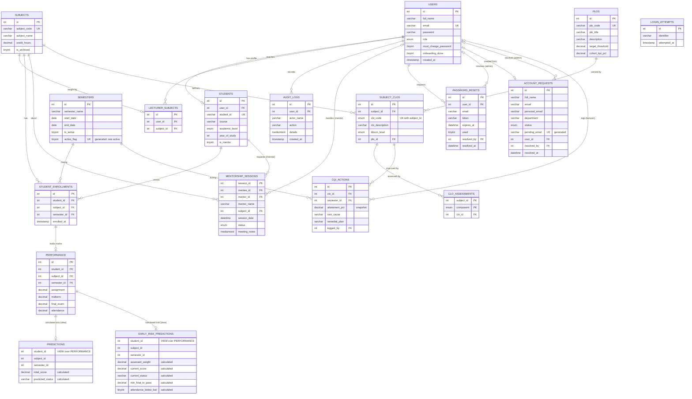

# SPTS — System Workflow & ERD Guide

> Generated from the **live database** after the September 2026 fault fixes (`database/schema.sql`). Column types are exact.

---

## PART A — SYSTEM WORKFLOW

### A1. Overall flow (big picture)

```
                         ┌──────────────────────┐
                         │  Landing Page         │
                         │  (index.php)          │
                         └──────────┬───────────┘
              ┌─────────────────────┼─────────────────────┐
              ▼                     ▼                     ▼
       Register (student)     Login (student)      Login (staff/admin)
              │                     │                     │
              └──────────► users + students               │
                                    ▼                     ▼
                  ┌── temporary password? → Change Password first ──┐
                  ▼                     ▼                           ▼
            ADMIN PORTAL         LECTURER PORTAL              STUDENT PORTAL
                  │                     │                           │
   semesters, subjects, staff,   enters marks (grid/CSV) for  views this semester's
   students, ENROLMENTS,         ENROLLED students in the     results, what-if, books
   password requests, audit log  ACTIVE semester → score,     mentorship, prints
                  │              status, audit log            multi-semester transcript
                  └──────────────────► shared database ◄──────────────────┘
```

### A2. Setup workflow (first-time install)

1. Import `database/schema.sql` and create the `spts_app` DB user (README).
2. Run `tools/create_admin.php` → first **admin** (must change password at first login).
3. Admin → **Semesters**: add the semester, *Set Active* (exactly one active semester).
4. Admin → **Staff**: add lecturers (and other admins if needed).
5. Admin → **Subjects**: add subjects, assign one lecturer each.
6. Admin adds students under **Students** (self-registration is off by default; see `ALLOW_SELF_REGISTRATION`).
7. Admin → **Enrolments**: tick which students take each subject this semester.

### A3. Authentication workflow

```
User enters email + password
        │
        ├─ CSRF token invalid? ──────────────► "Session expired"
        ├─ ≥5 failed tries in 15 min? ──────► Blocked (login_attempts)
        ▼
Look up users.email
        ├─ not found / wrong password ─► INSERT login_attempts → "Invalid email or password"
        ▼
Correct → DELETE login_attempts → new session ID
        ├─ users.must_change_password = 1 → forced to Change Password
        └─ otherwise → dashboard for role (admin / lecturer / student)

Every page: idle > 30 min → signed out ("signed out after inactivity")
Logout: POST + CSRF token only
```

**Registration.**
1. Validate the input:
   - email format
   - Student ID format `n` + 7–10 digits
   - programme belongs to the level detected from the ID
   - password: 8+ characters with a letter and a number
   - email and Student ID are unique
2. Start a transaction.
3. INSERT `users` (role = student).
4. INSERT `students`.
5. COMMIT, or ROLLBACK if anything fails.

**Forgot password** (admin-mediated; the page never changes a password itself):
1. The user submits email + full name. The same reply is shown whether or not they match, and requests are rate-limited.
2. If they match, a `password_resets` row is created (open for 7 days).
3. The admin checks the person's identity and opens **Password Requests**.
4. The admin clicks **Issue Temporary Password**. This updates `users.password` and sets `must_change_password = 1`. The request is marked `used = 1` with `resolved_by` and `resolved_at`.
5. At next login the user must set their own password.

### A4. Admin workflow

| Step | Action | Tables affected |
|---|---|---|
| 1 | Dashboard: counts, status doughnut, avg-by-subject (active semester, active subjects) | reads `students`, `subjects`, `predictions`, `student_enrollments` |
| 2 | Semesters: add, set active, delete (only if unused) | `semesters` |
| 3 | Subjects: add, edit name/lecturer, archive, restore | `subjects`, `lecturer_subjects` |
| 4 | Enrolments: tick students per subject for the active semester | `student_enrollments` |
| 5 | Students: add, edit programme/year, reset password, peer-mentor flag, delete | `users`, `students` |
| 6 | Staff: add lecturer/admin, reset lecturer password, delete lecturer | `users` (+ upcoming `mentorship_sessions` → Declined) |
| 7 | Password Requests: issue temporary password / reject | `password_resets`, `users` |
| 8 | Audit Log: all mark changes, filter by lecturer/action/text | reads `audit_logs` |
| 9 | View Student: profile + results for every semester | reads `students`, `student_enrollments`, `semesters`, `performance`, `predictions` |

### A5. Lecturer workflow — mark entry (core process)

```
Lecturer logs in
      │
      ▼
System loads the lecturer's NON-ARCHIVED subjects (lecturer_subjects)
and the ACTIVE semester (semesters.is_active = 1)
      │
      ├──────────── Option 1: Mark Entry Grid ────────────┐
      │   Pick subject → grid lists ENROLLED students     │
      │   (student_enrollments for this subject+semester) │
      │   Type marks (blank = not assessed yet) → Save    │
      │                                                   │
      ├──────────── Option 2: CSV Upload ─────────────────┤
      │   Download template (pre-filled with the roster)  │
      │   Only own subjects + enrolled students accepted  │
      │                                                   ▼
      │                      For each student row (one DB transaction):
      │                      1. Validate: each mark numeric 0–100 or blank
      │                      2. Nothing changed? → skip
      │                      3. Upsert raw marks  → PERFORMANCE (student, subject, semester)
      │                      4. All 4 present?  total = A×0.2 + M×0.3 + F×0.4 + T×0.1
      │                           → classify ≥80 Excellent, ≥60 Pass, ≥50 At Risk, else Fail
      │                           → upsert PREDICTIONS
      │                         Incomplete? → delete any PREDICTIONS row (status "Pending")
      │                      5. Record old → new values → AUDIT_LOGS (with actor_name)
      │                                                   │
      ▼                                                   ▼
View own Audit Trail                     Results visible to Admin & Student
```

### A6. Mentorship (consultation) workflow

```
STUDENT (mentee)                                MENTOR (lecturer of the subject, or
                                                peer mentor: is_mentor student who
                                                scored Excellent in that subject)
────────────────                                ──────────────────────────────────
Sees At-Risk/Fail alert (this semester's PREDICTIONS)
Picks an enrolled subject → sees valid mentors
Books: future date (≤180 days), notes ≤500 chars
  server checks: valid mentor for subject, no open
  duplicate, mentor free ±60 min
  → MENTORSHIP_SESSIONS status = Pending ──────►  Requires Action
                                                   ├─ Approve     → Approved
                                                   ├─ Reschedule  → Approved at new time
                                                   └─ Decline     → Declined
Can Cancel while Pending/Approved → Cancelled      Approved: Cancel → Declined,
                                                   after the session: Complete → Completed
```

Status lifecycle: `Pending → Approved → Completed`. A session can also end as `Declined` (by the mentor) or `Cancelled` (by the student).
If the lecturer's account is deleted, their Pending/Approved sessions become Declined. The session history stays, and the name is kept in `mentor_name`.

### A7. Student workflow

1. **Dashboard:** shows each subject the student is enrolled in this semester, with marks so far ("—" if not assessed), the total, and the status (Pending until all 4 marks are in).
2. **What-If Calculator:**
   1. Pick one of your enrolled subjects.
   2. Your official assignment, midterm and attendance marks for this semester are loaded and locked.
   3. Try final-exam values to see the projected result. **Nothing is saved.**
3. **Mentorship:** see A6. Peer mentors also get a "Requests to Me" inbox.
4. **Transcript:** one block per semester.
   - Each semester shows its courses, weightage, GP, GPA, and the cumulative weightage, GP and CGPA.
   - A subject without complete marks shows "GP" (Grades Pending) and is not counted in the GPA.
   - Passing subjects scoring 50–59 show "At Risk" in Remarks.

---

## PART B — ERD INFORMATION

### B1. Entities and attributes

**1. USERS** — every login account
| Attribute | Type | Key |
|---|---|---|
| id | INT AUTO_INCREMENT | **PK** |
| full_name | VARCHAR(100) | |
| email | VARCHAR(100) | UNIQUE |
| password | VARCHAR(255) (bcrypt hash) | |
| role | ENUM('admin','student','lecturer'), NOT NULL (can't change while subjects or a student profile depend on it — trigger) | |
| must_change_password | TINYINT(1) | |
| onboarding_done | TINYINT(1) (first-login guide shown) | |
| created_at | TIMESTAMP | |

**2. STUDENTS** — student profile (extends USERS)
| Attribute | Type | Key |
|---|---|---|
| id | INT AUTO_INCREMENT | **PK** |
| user_id | INT | **FK → USERS.id**, UNIQUE, ON DELETE CASCADE |
| student_id | VARCHAR(20), e.g. `n00021960` | UNIQUE |
| course | VARCHAR(100) | |
| academic_level | ENUM('Diploma','Degree','Masters','PhD') | |
| year_of_study | INT, CHECK 1–3 | |
| is_mentor | TINYINT(1), NOT NULL (peer mentor flag) | |

**3. SEMESTERS**
| Attribute | Type | Key |
|---|---|---|
| id | INT AUTO_INCREMENT | **PK** |
| semester_name | VARCHAR(50), e.g. "September 2026" | |
| start_date | DATE | |
| end_date | DATE, CHECK end_date > start_date | |
| is_active | TINYINT(1), NOT NULL | |
| active_flag | generated: 1 if active, else NULL | UNIQUE (so at most one semester is active) |
| created_at | TIMESTAMP | |

**4. SUBJECTS**
| Attribute | Type | Key |
|---|---|---|
| id | INT AUTO_INCREMENT | **PK** |
| subject_code | VARCHAR(20), e.g. `EC2301` | UNIQUE |
| subject_name | VARCHAR(100) | |
| credit_hours | DECIMAL(3,1), NOT NULL, default 3.0, CHECK 1.0–6.0 (weights the subject in GPA) | |
| is_archived | TINYINT(1), NOT NULL | |

**5. LECTURER_SUBJECTS** — which lecturer teaches which subject
| Attribute | Type | Key |
|---|---|---|
| id | INT AUTO_INCREMENT | **PK** |
| user_id | INT | **FK → USERS.id**, CASCADE; must be a lecturer (enforced by trigger) |
| subject_id | INT | **FK → SUBJECTS.id**, UNIQUE (one lecturer per subject), CASCADE |

**6. STUDENT_ENROLLMENTS** — which student takes which subject in which semester
| Attribute | Type | Key |
|---|---|---|
| id | INT AUTO_INCREMENT | **PK** |
| student_id | INT | **FK → STUDENTS.id**, CASCADE |
| subject_id | INT | **FK → SUBJECTS.id**, CASCADE |
| semester_id | INT | **FK → SEMESTERS.id**, RESTRICT (a semester in use can't be deleted) |
| enrolled_at | TIMESTAMP | |

UNIQUE (student_id, subject_id, semester_id). INDEX (subject_id, semester_id) for class rosters.

**7. PERFORMANCE** — raw marks
| Attribute | Type | Key |
|---|---|---|
| id | INT AUTO_INCREMENT | **PK** |
| student_id | INT | part of the enrolment FK below |
| subject_id | INT | part of the enrolment FK below (indexed) |
| semester_id | INT | part of the enrolment FK below (indexed) |
| assignment | DECIMAL(5,2), NULL = not assessed; CHECK 0–100 (all four marks) | |
| midterm | DECIMAL(5,2), NULL allowed | |
| final_exam | DECIMAL(5,2), NULL allowed | |
| attendance | DECIMAL(5,2), NULL allowed | |
| created_at | TIMESTAMP | |

UNIQUE (student_id, subject_id, semester_id).
**FK (student_id, subject_id, semester_id) → STUDENT_ENROLLMENTS**, CASCADE: marks can only exist for an enrolment. This is the table's only foreign key: deleting a student or subject removes the enrolment and its marks with it, and a semester with enrolments can't be deleted.

**8. PREDICTIONS** — a **VIEW**, not a table: the result calculated from PERFORMANCE when it is read
| Column | Calculated as |
|---|---|
| student_id, subject_id, semester_id | from PERFORMANCE (its key) |
| total_score | ROUND(Assignment×0.20 + Midterm×0.30 + Final Exam×0.40 + Attendance×0.10, 2) |
| predicted_status | ≥ 80 'Excellent' · ≥ 60 'Pass' · ≥ 50 'At Risk' · else 'Fail' (from the rounded total) |

A row appears only when all four marks are entered. Nothing is stored, so a result can never disagree with its marks (this is what makes the schema strictly 3NF; see B6). The view is merged into queries and uses PERFORMANCE's unique index, so reading it is as fast as reading a table.

**9. AUDIT_LOGS**
| Attribute | Type | Key |
|---|---|---|
| id | INT AUTO_INCREMENT | **PK** |
| user_id | INT, NULL | **FK → USERS.id**, ON DELETE SET NULL |
| actor_name | VARCHAR(100) (kept after the account is deleted) | |
| action | VARCHAR(255) ('Manual Mark Entry', 'CSV Upload', 'Account request approved/rejected') | |
| details | MEDIUMTEXT (student, subject, old → new marks, result) | |
| created_at | TIMESTAMP | INDEX (user_id, created_at), INDEX (created_at) |

**10. MENTORSHIP_SESSIONS**
| Attribute | Type | Key |
|---|---|---|
| session_id | INT AUTO_INCREMENT | **PK** |
| mentee_id | INT | **FK → STUDENTS.id**, CASCADE |
| mentor_id | INT, NULL | **FK → USERS.id**, SET NULL; must be a lecturer or a peer-mentor student other than the mentee (enforced by trigger). INDEX (mentor_id, session_date) |
| mentor_name | VARCHAR(100) (kept after the account is deleted) | |
| subject_id | INT | **FK → SUBJECTS.id**, CASCADE |
| session_date | DATETIME | |
| status | ENUM('Pending','Approved','Completed','Declined','Cancelled'), NOT NULL | |
| meeting_notes | MEDIUMTEXT | |
| created_at | TIMESTAMP | |

**11. PASSWORD_RESETS** — reset requests waiting for an admin
| Attribute | Type | Key |
|---|---|---|
| id | INT AUTO_INCREMENT | **PK** |
| user_id | INT, NOT NULL | **FK → USERS.id**, CASCADE |
| email | VARCHAR(100) (snapshot of the address used for the request) | |
| token | VARCHAR(255) (random reference) | |
| expires_at | DATETIME | INDEX (used, expires_at) |
| used | TINYINT(1), NOT NULL (1 = resolved) | |
| resolved_by | INT, NULL | **FK → USERS.id** (the admin), SET NULL |
| resolved_at | DATETIME | |
| created_at | TIMESTAMP | |

**12. LOGIN_ATTEMPTS** — standalone security table (no FK)
| Attribute | Type | Key |
|---|---|---|
| id | INT AUTO_INCREMENT | **PK** |
| identifier | VARCHAR(191) ("email\|IP", or "reset:email\|IP") | INDEX |
| attempted_at | TIMESTAMP | INDEX (rows older than a day are deleted automatically) |

**13. ACCOUNT_REQUESTS** — new lecturers asking for an account
| Attribute | Type | Key |
|---|---|---|
| id | INT AUTO_INCREMENT | **PK** |
| full_name | VARCHAR(100) | |
| email | VARCHAR(100) (university email; becomes the sign-in email) | INDEX |
| personal_email | VARCHAR(100) (where sign-in details are sent) | |
| staff_id | VARCHAR(30), NULL | |
| department | VARCHAR(100) | |
| message | VARCHAR(500), NULL | |
| status | ENUM('Pending','Approved','Rejected') | INDEX |
| pending_email | generated: email while Pending, else NULL | UNIQUE (one pending request per email) |
| reject_reason | VARCHAR(255), NULL | |
| user_id | INT, NULL (account created on approval) | **FK → USERS.id**, SET NULL |
| resolved_by | INT, NULL (the admin) | **FK → USERS.id**, SET NULL |
| resolved_at | DATETIME | |
| created_at | TIMESTAMP | |

**14. PLOS** — Programme Learning Outcomes
| Attribute | Type | Key |
|---|---|---|
| id | INT AUTO_INCREMENT | **PK** |
| plo_code | VARCHAR(10), e.g. `PLO1` | UNIQUE |
| plo_title | VARCHAR(100) | |
| description | VARCHAR(255) | |
| target_threshold | DECIMAL(5,2), default 50 (score a student needs to attain it) | |
| cohort_kpi_pct | DECIMAL(5,2), default 80 (share of the class that must attain it) | |

**15. SUBJECT_CLOS** — Course Learning Outcomes, CLO1–CLO4 per subject
| Attribute | Type | Key |
|---|---|---|
| id | INT AUTO_INCREMENT | **PK**; UNIQUE (id, subject_id) as the target of CLO_ASSESSMENTS' composite FK |
| subject_id | INT | **FK → SUBJECTS.id**, CASCADE |
| clo_code | ENUM('CLO1'…'CLO4') | UNIQUE (subject_id, clo_code) |
| clo_description | VARCHAR(255) | |
| bloom_level | ENUM C1–C6 (cognitive), P1–P7 (psychomotor), A1–A5 (affective) | |
| plo_id | INT | **FK → PLOS.id**, RESTRICT |

**16. CLO_ASSESSMENTS** — which CLO each mark component assesses
| Attribute | Type | Key |
|---|---|---|
| subject_id | INT | **PK** (subject_id, component) |
| component | ENUM('assignment','midterm','final_exam','attendance') | |
| clo_id | INT | **FK (clo_id, subject_id) → SUBJECT_CLOS (id, subject_id)**, CASCADE — the CLO must belong to the same subject |

**17. CQI_ACTIONS** — a lecturer's response to a CLO below its class KPI
| Attribute | Type | Key |
|---|---|---|
| id | INT AUTO_INCREMENT | **PK** |
| clo_id | INT | **FK → SUBJECT_CLOS.id**, CASCADE; UNIQUE (clo_id, semester_id) |
| semester_id | INT | **FK → SEMESTERS.id**, RESTRICT |
| attainment_pct | DECIMAL(5,2) (class attainment when the action was logged — a snapshot) | |
| root_cause, remedial_plan | VARCHAR(500) each | |
| logged_by | INT, NULL | **FK → USERS.id**, SET NULL |
| created_at, updated_at | TIMESTAMP | |

**18. EARLY_RISK_PREDICTIONS** — a **VIEW** over PERFORMANCE for rows with at least one mark
| Column | Calculated as |
|---|---|
| student_id, subject_id, semester_id, the four marks | from PERFORMANCE |
| assessed_weight | sum of the weights of the components entered (0.10–1.00) |
| current_score | weighted average of the components entered, rescaled to 0–100 (equals total_score once all four are in) |
| current_status | the usual bands applied to current_score |
| min_final_to_pass | (60 − coursework points) ÷ 0.40, when assignment, midterm and attendance are in and the final isn't |
| attendance_below_bar | 1 when attendance < 80 (barred from the final exam, BE) |

> All tables use utf8mb4 (full Unicode, including emoji), and the app runs every connection in strict SQL mode, so invalid values are rejected rather than silently changed.

> Tip: LOGIN_ATTEMPTS has no relationships. Leave it out of the main ERD, or draw it as a separate box.

### B2. Relationships and cardinality

| # | Relationship | Cardinality | Via (FK) | Explanation |
|---|---|---|---|---|
| R1 | USERS **has** STUDENTS | 1 : 0..1 | students.user_id (UNIQUE) | Student accounts have one profile; admins and lecturers have none |
| R2 | USERS (lecturer) **teaches** SUBJECTS | 1 : N, via LECTURER_SUBJECTS | lecturer_subjects.user_id, .subject_id (UNIQUE) | A lecturer teaches many subjects; each subject has at most one lecturer |
| R3 | STUDENTS **enrols in** SUBJECTS **during** SEMESTERS | M : N : N, via STUDENT_ENROLLMENTS | student_id, subject_id, semester_id | A ternary relationship |
| R4 | STUDENTS / SUBJECTS / SEMESTERS **have** PERFORMANCE | each 1 : N, through the enrolment | (see R6) | One marks row per student, subject and semester |
| R5 | PERFORMANCE **produces** PREDICTIONS (view) | 1 : 0..1 | calculated, not a foreign key | A result exists once all 4 marks are present |
| R6 | STUDENT_ENROLLMENTS **has** PERFORMANCE | 1 : 0..1 | composite FK (student_id, subject_id, semester_id) | Marks can only exist for an enrolment |
| R7 | USERS (lecturer) **writes** AUDIT_LOGS | 1 : N | audit_logs.user_id (SET NULL) | |
| R8 | STUDENTS (mentee) **requests** MENTORSHIP_SESSIONS | 1 : N | mentee_id | |
| R9 | USERS (mentor) **handles** MENTORSHIP_SESSIONS | 1 : N | mentor_id (SET NULL) | The mentor is a lecturer or a peer-mentor student's user account |
| R10 | SUBJECTS **is topic of** MENTORSHIP_SESSIONS | 1 : N | subject_id | |
| R11 | USERS **requests** PASSWORD_RESETS | 1 : N | password_resets.user_id | |
| R12 | USERS (admin) **resolves** PASSWORD_RESETS and ACCOUNT_REQUESTS | 1 : N | resolved_by (SET NULL) | |
| R13 | ACCOUNT_REQUESTS **creates** USERS (lecturer) | 0..1 : 0..1 | account_requests.user_id (SET NULL) | Set when the admin approves the request |
| R14 | SUBJECTS **defines** SUBJECT_CLOS | 1 : 0..4 | subject_clos.subject_id | Each subject has CLO1–CLO4 |
| R15 | PLOS **is served by** SUBJECT_CLOS | 1 : N | subject_clos.plo_id (RESTRICT) | Each CLO contributes to one PLO |
| R16 | SUBJECT_CLOS **is assessed by** CLO_ASSESSMENTS | 1 : 0..4 | composite FK (clo_id, subject_id) | Each mark component of a subject assesses exactly one of its CLOs |
| R17 | SUBJECT_CLOS **gets** CQI_ACTIONS **in** SEMESTERS | 1 : N, one per semester | clo_id, semester_id | |
| R18 | USERS (lecturer) **logs** CQI_ACTIONS | 1 : N | logged_by (SET NULL) | |
| R19 | PERFORMANCE **produces** EARLY_RISK_PREDICTIONS (view) | 1 : 0..1 | calculated, not a foreign key | A row exists once any mark is present |

### B3. Simplified ERD sketch

```
                      ┌──────────────┐        1      N ┌─────────────────┐
                      │    USERS     │─────────────────►│ PASSWORD_RESETS │
                      │ PK id        │                  └─────────────────┘
                      └─┬───┬────┬───┘
            1 (student) │   │    │ 1 (lecturer)            1      N ┌────────────┐
                        │   │    └─────────────────────────────────►│ AUDIT_LOGS │
                 0..1   │   │ 1 (lecturer)                          └────────────┘
               ┌────────▼─┐ │ N   ┌───────────────────┐  N    1 ┌──────────┐
               │ STUDENTS │ └────►│ LECTURER_SUBJECTS │◄────────│ SUBJECTS │
               │ PK id    │       └───────────────────┘         │ PK id    │
               └┬──┬──┬──┬┘                                     └┬──┬──┬──┬┘
                │  │  │  │ 1                                    1│  │  │  │
                │  │  │  └──────► STUDENT_ENROLLMENTS ◄──────────┘  │  │  │
                │  │  │ 1                  ▲ N                      │  │  │
                │  │  └─────────► PERFORMANCE ◄──────────────────────┘  │  │
                │  │ 1                 ▲ N                              │  │
                │  └────────────► PREDICTIONS ◄──────────────────────────┘  │
                │ 1                    ▲ N                                  │
                └─────────► MENTORSHIP_SESSIONS ◄───────────────────────────┘
                                   ▲ N (mentor_id → USERS)
                ┌───────────┐
                │ SEMESTERS │ 1 ──► N STUDENT_ENROLLMENTS ──► PERFORMANCE
                └───────────┘
```

> PREDICTIONS is a **view** calculated from PERFORMANCE (it stores nothing). The sketch shows where results come from; B4 has the exact relationships.

### B4. Ready-to-render ERD (Mermaid)

Paste this into **https://mermaid.live** or draw.io (Arrange → Insert → Advanced → Mermaid):



### B5. Notes for drawing the ERD correctly

- **PREDICTIONS and EARLY_RISK_PREDICTIONS are views.** Draw them with a dashed border (or label them «view»), connected only to PERFORMANCE. They have no stored rows and no foreign keys of their own.

- **USERS is a supertype.** Admin, Lecturer and Student are told apart by `role`. Only students get an extra table (STUDENTS). Show this as a disjoint specialisation (ISA), or as a 1 : 0..1 relationship.
- **"student_id" means two things:**
  - `students.student_id` is the matric number (text).
  - `student_id` in PERFORMANCE, PREDICTIONS and STUDENT_ENROLLMENTS, and `mentee_id`, all point to **`students.id`** (the numeric PK).
- **SEMESTERS is central.** Enrolments, marks and results are all per semester. That is what gives the transcript its per-semester GPA and cumulative CGPA.
- **Associative entities:** LECTURER_SUBJECTS, STUDENT_ENROLLMENTS, PERFORMANCE and PREDICTIONS resolve many-to-many relationships.
- **mentor_id points to USERS.** The mentor can be a lecturer or a peer-mentor student's user account.
- **Delete rules worth showing:**
  - Deleting a user **cascades** to their student profile, enrolments, marks and sessions as mentee.
  - AUDIT_LOGS and MENTORSHIP_SESSIONS (mentor side) use **SET NULL**, so history survives.
  - A semester that has marks cannot be deleted (**RESTRICT**).

### B6. Normalization

**From one flat result slip to the final tables**

- **UNF.** Student (matric no., name, email, course, level, year), semester (name, dates), and a *repeating group* of subject (code, name, lecturer) + four marks + total + status.
- **1NF.** Remove the repeating group: one row per student, subject and semester, every value atomic. Key: (matric_no, subject_code, semester_name).
- **2NF.** Remove partial dependencies on part of that key:
  - matric_no → name, email, course, level, year → **USERS** + **STUDENTS**
  - subject_code → subject name, lecturer → **SUBJECTS** + **LECTURER_SUBJECTS**
  - semester_name → dates → **SEMESTERS**
  - the whole key → enrolment and marks → **STUDENT_ENROLLMENTS** + **PERFORMANCE**
- **3NF.** Remove transitive dependencies:
  - subject → lecturer → lecturer's name/email: the lecturer is a reference (user_id) into USERS, not copied text.
  - Login details (email, password, role) belong to every kind of user, so they live in USERS; STUDENTS keeps only student-specific columns.
  - marks → total → status: the total and status are **not stored**. PREDICTIONS is a view that calculates them from PERFORMANCE.

**Result:** every table is in **3NF**, and all except the six marked 3NF below are also in **BCNF**.

| Table | Candidate keys | Normal form |
|---|---|---|
| users | id, email | BCNF |
| students | id, user_id, student_id | BCNF (academic_level depends on student_id, a candidate key) |
| subjects | id, subject_code | BCNF |
| semesters | id | 3NF (see generated columns below) |
| lecturer_subjects | id, subject_id | BCNF |
| student_enrollments | id, (student, subject, semester) | BCNF |
| performance | id, (student, subject, semester) | BCNF |
| mentorship_sessions | session_id | 3NF |
| password_resets | id | 3NF |
| account_requests | id | 3NF (see generated columns below) |
| audit_logs | id | 3NF |
| login_attempts | id | BCNF |
| plos | id, plo_code | BCNF |
| subject_clos | id, (subject_id, clo_code) | BCNF |
| clo_assessments | (subject_id, component), (clo_id, component) | 3NF (see below) |
| cqi_actions | id, (clo_id, semester_id) | BCNF (attainment_pct is a snapshot) |
| *predictions*, *early_risk_predictions* | — | views; store nothing |

**Points that look like redundancy but aren't 3NF violations**

- **Snapshot columns**: `audit_logs.actor_name`, `mentorship_sessions.mentor_name`, `password_resets.email`, and the name/email in `account_requests`. They record the value *at the time of the event*. If the user is renamed or deleted, these rows keep the old value, so they are not determined by `user_id`. They are facts about the event, which is why the audit trail survives account deletion.
- **clo_assessments.subject_id**: `clo_id → subject_id` (a CLO belongs to one subject) and `clo_id` is not a key on its own, so the table is 3NF but not BCNF — `subject_id` is part of the key (subject_id, component), which 3NF allows. Keeping it is deliberate: the primary key can then enforce "each component of a subject assesses exactly one CLO", and the composite foreign key (clo_id, subject_id) guarantees the two can never disagree. Removing it would need a trigger for the same rule.
- **cqi_actions.attainment_pct**: the class attainment the lecturer responded to, recorded with the action. Later mark changes don't rewrite it, so it is a fact about the action, not derived data.
- **Generated columns**: `semesters.active_flag` and `account_requests.pending_email`. The database calculates them from other columns, so they can never disagree with their source. They exist only so a UNIQUE index can enforce "one active semester" and "one pending request per email". Under a strictly literal reading they are derived values, so those two tables are listed as 3NF rather than BCNF.
